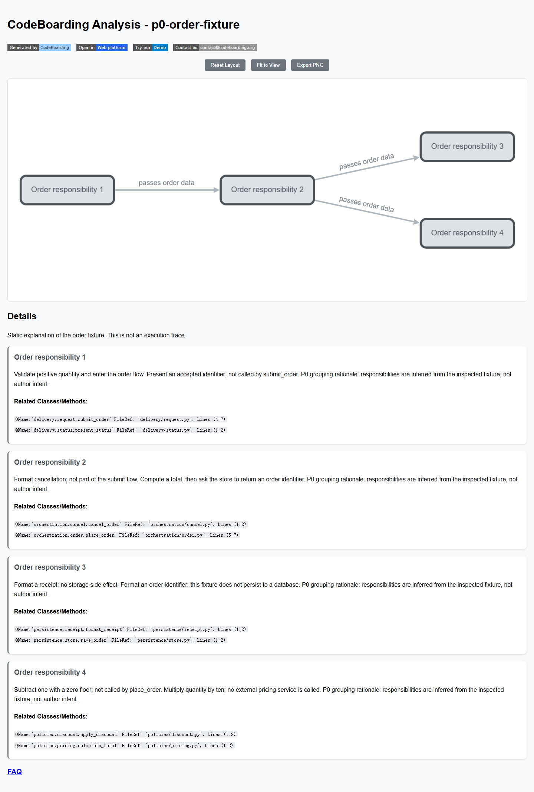

# P2 整改实测：2026-11-04（Asia/Shanghai）

两项整改均已完成并重跑真实链路。下列为本轮证据；后面的“历史 P0”章节保留首次交付的调查与运行记录，其工程检查数值不代表本轮。当前 results.json、facts、semantics、snapshots、browser-results.json 和 renderer.png 均来自 `temp/p2-final-verified` 新执行，未沿用历史成功产物。

执行起点为 `a57e2e773a7e79971e202ca2fafe903e5347c399`，工作区初始干净；本轮执行时包含未提交的 P2 脚本改动。results.json 记录 UTC 启动时间 `2026-11-04T09:13:26.671629+00:00`（本地 17:13:26）及三个执行脚本的实际字节 SHA-256。最终提交在 PR head 中；不以执行起点 SHA 冒充已提交的新代码版本。Git fetch 连接重置，通过 GitHub PR API 和 gh ref 读取确认远端仍为该基线。

环境：Windows 11 Pro x64 10.0.26100；Python 3.12.13；Node 24.20.0；Pyright 1.1.400；Tokei 14.0.0（既有 tools-2026.04.05 二进制）；Playwright 1.62.1；Edge 156.0.4314.58。PostHog SDK 7.18.0；其他关键 Python 依赖见 results.json.environment。固定浏览器图依赖仍为 dagre 0.8.5、Cytoscape 3.23.0、cytoscape-dagre 2.4.0。未安装或升级依赖。

| 本轮验证 | 实际退出码与结果 |
|---|---|
| 未继承遥测关闭变量，直接执行 experiment.py | 0；PASS，telemetry_client_absent=true，guard_attempts=[]，unfinished_threads=[] |
| 真实引擎、语义、持久化与 renderer | 0；8 callable、3 调用边、4 组件、有限语义保存/重读；原子替换失败保持原文件 |
| 原生刷新结论 | 原始内容 hash 与体编辑后的 hash 不同；成员从 4 移到 1 可保存，内存 service.spec 重放后恢复至 4；ID 和旧描述保留，独立 scenarios/rationale 仍丢失 |
| guard 对照程序 check-guard-negatives.py | 0（测试通过）；完整旧实验注入并吞掉一次 socket.connect 异常，旧退出码 0、A/B PASS、日志仍称 passed；记录含该调用。新版 caught/thread/exit 三个受控探针均退出 1，结果 FAIL、各有一次 socket.connect、无成功日志 |
| 图形库缺失对照 | 测试通过；原生 HTML 临时副本移除 Cytoscape script，4 详情和 8 位置仍在；旧检查器 0，新检查器 1，报告 FAIL |
| 初始化异常对照 | 测试通过；原生初始化位置抛错（原生 catch 记录 console.error）；旧检查器 0，新检查器 1，报告 FAIL |
| 最后正常页面检查 | 0；真实可见四节点、三条预期边；4 详情/8 源码位置/0 源码链接；page_errors、console_errors、failed_dependencies 均为空；截图已实际查看 |

负例驱动程序成功与被测检查器失败分别记录在 [guard-negative-results.json](guard-negative-results.json)、[browser-negative-results.json](browser-negative-results.json)。实际命令见 [README 整改复现](README.md#p2-审阅整改复现2026-11-041708-起)。测试中的 telemetry_client_absent=false 表示 standalone guard 探针根本没有导入原生 telemetry；真实正例字段为 true。没有真实外发，故障在 socket 调用进入 OS 前终止。

根因 A：原生 telemetry singleton 在 import 时初始化，run 内关闭太晚；吞掉 guard 异常后，原脚本没有最终累计失败判定。修复为原生导入前 opt-out + client 空值断言 + 进程生命周期保护和最终统一判定。具体覆盖与线程/退出收尾边界见 README。根因 B：旧检查只以静态详情为通过条件。修复为观察真实原生图实例和渲染边界，并拒绝脚本错误、缺失依赖及图初始化失败。

本轮未实现跨进程 TreeSpec 恢复、解释正确性自动复核、业务执行验证或 M1 产品功能。源码跳转仍为 0 个链接，CDN 依赖仍需联网加载。Python guard 的结果不扩称为任意第三方子进程的网络隔离证明。

## 本轮工程门禁

命令及机器摘要见 [engineering-results.json](engineering-results.json)，完整原始日志保留在 ignored temp。

| 本轮命令 | 实际结果 |
|---|---|
| `uv run black . --check` | 0，通过 |
| `uv run mypy .` | 1；检查 332 源文件，仅 `static_analyzer/workspace_dependencies.py:78` 的 Windows signal.SIGKILL attr-defined 错误 |
| README 中四个聚焦测试文件的 pytest 命令 | 1；63 passed、2 failed，4.97s；两个 ScopeAssembler 相对路径断言失败 |
| 固定生产基线重新执行 ScopeAssembler 测试 | 1；20 passed、相同 2 failed，3.55s；从 temp/p0-baseline 根目录、激活同一 venv 后执行 `python -m pytest tests/diagram_analysis/test_scope_assembly.py -q` |
| 固定生产基线重新执行 `python -m mypy .` | 1；329 源文件，同一 SIGKILL 错误；相关两个生产文件与当前树逐文件 diff 相同 |
| `uv run pytest --cov=. --cov-report=term --cov-fail-under=80` | 实际退出 -1（主动终止测试进程）；collected 2699，在 test_edge_builder.py 附近约 67% 连续约四分四十秒无新输出后停止；已出现多处失败，没有最终覆盖率报告，80% 门槛未确认 |

只有两个聚焦失败与类型错误完成了本轮基线归因；全仓其他失败尚未逐项归因。private CodeBoarding-tests 集成套件未执行。提交时运行原有 pre-commit Black hook，不降低任何工程门禁。

---

# 历史 P0 实验记录：2026-11-04，首次交付

输入：核心 `156806c0eedcfded65eb8d02c39b3cf618a8254b`，仓库 uv.lock；本目录八文件 fixture。规范化源码 hash `f89db7e0ca7ffbf7268fcbde329b353011204c976cc1e28ef0d3aa1091bc45d0`（使用原生 compute_source_tree_hash）。Python 3.12.13、Node 24.20.0、Pyright 1.1.400、Tokei tools-2026.04.05，Windows 11 x64。关键 Python 依赖见 [results.json](results.json)。执行命令见 [README](README.md#复现)。

## 实验 A：静态结构 → 外部语义 → 原生保存 → 原生 renderer

实际入口：StaticAnalyzer context manager/analyze(skip_cache=True) → ClusteringService.build_full_hierarchy(max_depth=1) → ScopeAssembler.build → ScopeAnalysisResult.model_validate 与 JSON Schema → apply_semantics → save_analysis → parse_unified_analysis → codeboarding_cli.render.main（真实 codeboarding-render 的 CLI 入口函数）。这是本 PR Python 适配，没有新增或声称已有原生 model-write CLI。

| 检查 | 实际结果 |
|---|---|
| 真实引擎输入与结构 | **通过**：8 文件、8 callable 节点、4 root groups、3 调用边；未调用业务函数，不是运行验证 |
| 外部语义 schema / 原生 JSON schema | **通过**，分别调用 jsonschema.validate 和 Pydantic；unknown 字段仍可被接受后忽略，因此不是完整业务模型校验器 |
| 保存、重读 | **通过**：ID、名称、描述、成员一致；8 key_entities 均解析到实际文件及行；3 关系标签由外部样例写入 |
| 内部 LLM 路径 | **通过（受控路径）**：配置、API-key 校验、初始化、scope agent 与 LangChain 入口 guard 零次；socket.connect 零次；LSP stdio 子进程不在 Python guard 的完整网络证明范围内 |
| 保存失败 | **通过**：模拟 os.replace 抛 OSError，原文件字节不变；这是单文件原子保存失败，不代表多文件事务 |
| 文档 HTML | **通过**：真实 renderer；Edge 无头浏览器读取 4 详情、8 源码位置、3 canvas；无 pageerror；截图人工检查图关系、文字和源码位置可见 |
| 名称、描述、理由 | **通过（有限表达）**：理由作为 description 内容可见；独立 rationale 字段 **发现限制：忽略/丢弃** |
| 点击源码跳转 | **发现限制**：8 条位置是文本，源码 a 标签数量 0；html.py 的 repo_path/project 前缀判断不匹配本次相对路径，不能称源码导航已交付 |
| 关系证据与业务条件 | **发现限制**：样例关系 label 在图上可见；独立 evidence/步骤/条件没有对应详情展示 |
| 官网交互画布、VS Code 操作 | **尚未验证**：没有加载用户线上账户、上传模型或运行扩展后端 |

Browser QA：Playwright 1.62.1，已安装的 Edge 156.0.4314.58，隔离无头上下文。HTML 通过 unpkg 加载 dagre 0.8.5、Cytoscape 3.23.0、cytoscape-dagre 2.4.0；图展示不是离线自包含。本轮没有点击 renderer 的官网推广链接。

```powershell
# 使用已有 Playwright，或 npm install --prefix temp/p0-tools playwright@1.62.1
$env:P0_PLAYWRIGHT_MODULE = (Resolve-Path temp/p0-tools/node_modules/playwright).Path
$env:P0_BROWSER_CHANNEL = 'msedge' # 已安装 Edge；或删除此变量并安装匹配 Chromium
node docs/design/external-agent-p0/check-render.cjs temp/p0-results
```

若无匹配浏览器，先安装 Playwright 所需 Chromium。实际本机使用桌面内置 Playwright 路径，运行报告记录其版本；它不是 Python 锁文件的一部分。



## 实验 B：同一对象的成员编辑与源码刷新

`snapshots/before.json`、`member-edit.json`、`refreshed.json` 是同一模型对象的连续审计快照；不是三次生成不同架构。脚本从 before 重新读取后修改对象，保留 ID 和解释，再刷新同一份内存模型并保存。

| 检查 | 实际结果 |
|---|---|
| 在语义 payload 中指定 members/parent_id | **发现限制**：字段不在原生 schema，解析忽略；apply_semantics 后成员不变，不构成结构修改 API |
| 真实跨目录成员调整 | **通过（内部 API）**：将 `policies/pricing.py` 从逻辑 ID 4 的 file_methods 移到 ID 1（delivery），保存与重读一致；ID 4 仍含 discount 文件 |
| 文件体编辑 | 将 quantity * 10 改为 * 12；实际 static warm start invalidates 1 file，保留 7 nodes/2 edges；re-LSP 1 file，恢复 1 inbound edge，最终仍 8 nodes/3 edges |
| 原生聚类增量入口 | **通过**：build_incremental_hierarchy 读取 persisted TreeSpec 和真实 incremental_base_results；populate_file_methods 重放成员 |
| 编辑后成员能否长期保持 | **发现限制**：pricing 回到 ID 4，离开 ID 1；单独改 file_methods 未改变 authoritative TreeSpec |
| 对象与解释 | **通过（一次函数体编辑）**：ID 1–4 保留，描述保留；pricing 的 method content_hash 改变 |
| 解释正确性与待复核 | **发现限制**：仍保留旧“乘十”描述，本次静态刷新不会自动标记业务解释 stale；必须由新增关联层维护复核状态 |
| 独立业务场景与理由的 roundtrip | **发现限制**：注入 scenarios / rationale，parse_unified_analysis + build_unified_analysis_json 后消失 |
| full/incremental/partial 完整语义工作流 | **尚未验证**；这些路径仍可能/需要调用内部模型；本次没有用 stub 冒充它们的成功 |
| 文件移动、符号改名、删除、完整重建与父子重设 | **尚未验证**；源码推导与建议见 README 身份表，不外推本次体编辑结果 |

精简日志（数值摘录，临时路径省略）：

```text
Static analysis complete: python: 8 files, 8 references, 8 nodes, 3 edges
Component symbol coverage: 8/8 assigned
static_analysis_cache: outcome=warmstart (changes=supplied)
update_cfg_for_changed_files: 1 changed (1 existing, 0 deleted)
Invalidated 1 files: kept 7 nodes, 2 edges, 7 references
Restored 1 of 1 cached inbound edge(s) via definitions
P0 probes passed; native model limitations reproduced
guard_attempts: []
browser: 4 details / 8 references / 0 source links / 3 canvases / page_errors []
```

最初四文件 fixture 被原生 ladder 归为一个小叶，无法实验跨组移动；draft.py 的 LEAF_UNITS=7 解释该结果。随后增加四个独立、明确未调用的辅助函数，使每个目录两文件，共八文件形成四组。未改原生聚类阈值，也未伪造 group。最初缺 Tokei 是环境问题，补齐固定官方二进制并核对 registry SHA-256 后真实分析才通过。

## 发布包与 MCP 证据边界

固定 URL：`https://marketplace.visualstudio.com/_apis/public/gallery/publishers/Codeboarding/vsextensions/codeboarding/0.14.2/vspackage`。下载未完整完成时已读取 ZIP 中完整的早期成员；这里只使用已完成成员的清单、文本和静态入口证据，不声称完整 archive inventory 或整体 VSIX hash 已验证。未执行、修改或再分发扩展源码/后端。

| 观察 | 证据与结论 |
|---|---|
| 发布 wrapper 许可 | `extension/LICENSE.txt` 与 `dist/LICENSE` 为 CODEBOARDING PROPRIETARY SOFTWARE LICENSE AGREEMENT，closed source 且限制修改、衍生、逆向和分发；package.repository 指向核心 MIT 仓库不能替代此许可。这里记录文本，不作法律适用解释 |
| 身份校验 | package.json SHA-256 `849248be172b00470c220ff3bf33b0e68a0f733ad6111c5b0ee6036d4d5d0fe4`；LICENSE.txt SHA-256 `55778bee684811a1eda54236e6b3f61a734b2d19e46192163e3a7dc99c32bc47` |
| Webview 的来源 | 包中有 `webview-ui/src` 与 package.json；依赖 React 19、@xyflow/react 12、ELK、Zustand。公开核心固定 commit 的递归树无 extension/webview/mcp 文件匹配。包内源文件可获得不等于可复制进 fork |
| 扩展 MCP 配置 | package.json 的 Copy MCP Config 命令；发布 `dist/extension.js` 的静态 bootstrap 连接 `http://127.0.0.1:<backend-port>/mcp`，wrapper service 启动单独 server 进程；有 codeboarding/mcpActivity 和 planImpact 消息。不是独立 mix-server 0.1.0 的 Python Markdown 聚合实现 |
| 扩展实际 tools/list 与模型读写 | **尚未验证**：本轮未运行专有后端，未取得其 tools/list/schema；不能由配置命令、活动消息或 plan impact 推断支持模型写入。独立公开 MCP 的两个实际工具和数据源已按源码核查 |
| 官网后端/画布许可与实现 | **尚未验证**：发布 README 宣称可加载 analysis.json 和分享/差异，未执行官网操作或确认完整公开许可 |

该部分采用普通 ZIP 成员与文本/静态发布入口检查，未产生 REA 反编译 Evidence。REA 6.7.0 doctor 显示当前 Codex 没有连接 REA 注册；未修改 MCP 配置或安装原生反编译引擎。后续展示/接口不依赖专有 wrapper，且 PR 不含其代码。

## 工程检查

P0 脚本所有断言、原生 renderer 与浏览器 QA 通过。`uv run black . --check` 通过。`uv run mypy .` 仅余现有 `static_analyzer/workspace_dependencies.py:78` 的 Windows signal.SIGKILL 错误，本轮脚本无类型错误。

聚焦检查命令：

```powershell
uv run pytest tests/diagram_analysis/test_scope_assembly.py tests/output_generators/test_rendering.py tests/static_analyzer/test_warmstart_changed_files.py tests/diagram_analysis/test_scope_plan.py -q
```

结果 63 passed、2 failed：ScopeAssembler 两个测试使用 `/repo` 风格路径，在本机 Windows 相对路径断言失败。以 `git archive 156806c…` 创建无本轮变更的临时基线，再执行同名两个测试，得到相同 2 failed（5.07s）。未修改原生实现或现有测试；不将失败写成绿灯。

全仓 `uv run pytest --cov=. --cov-report=term --cov-fail-under=80` 已执行，出现多项失败（例如缓存路径、LSP、Kotlin、source inspector），到 test_source_inspector.py 附近的 90% 后长时间无进展，最终主动停止；退出码 1，没有最终 coverage 报告，80% 门槛未确认通过。只针对上述两个 scope 测试完成了固定基线复现；其余失败未逐一诊断，不宣称全部属于基线问题。private CodeBoarding-tests 集成套件不可访问且不会在 fork PR 自动运行，未执行。
